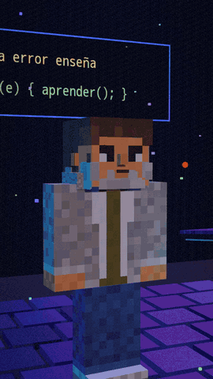

# AI Animated Shorts

A local CPU workflow for animated 3D dialogues with two configurable block-style characters, owned voice references and automatic audio checks. MIT-licensed project code; dependency and model licenses remain separate.

The pipeline is script → Chatterbox voice cache → per-line Whisper QA and bounded seed retries → three.js/Chromium rendering → music and voice mix → whole-video QA → local human review. It does **not** publish to social platforms.

Silent frames from the author's own series made with this workflow. The series characters have their own design; the repository ships neutral examples that you replace with yours.

No real voice recordings or reference photos are included. Supply your own voice (or written permission), two owned/licensed character references and matching JSON profiles. Never upload the private samples. See [feeding guide](docs/feeding.md) and [installation](docs/install.md).

Run dependency-free tests with `python3 -m unittest discover -s tests -v` and `bash tests/test_preflight.sh`. Production uses Docker Compose, CPU PyTorch 2.6, Chatterbox 0.1.7, faster-whisper 1.2, CTranslate2 4.8, Playwright 1.49, three.js 0.170 and FFmpeg 6.1.

Default output is vertical 720×1280 at 30 fps with burned-in subtitles off. Set `subtitles: true` in the JSON script to enable them. The final check requires more than 30 seconds; this is a project criterion, not a claim about platform eligibility.

The image helper proposes zone colors for a basic block rig, not automatic faithful 3D reconstruction. Numeric spelling, languages without word boundaries, alignment and facial expression remain imperfect. A human must listen and inspect the four QA frames.

Containers need initial package/model downloads; inference containers subsequently have networking disabled. A reference mini PC has four Intel i5 cores and 32 GB RAM; an optional Raspberry Pi only hosts the review output. See [limitations](docs/limitations.md) for what was actually tested.
