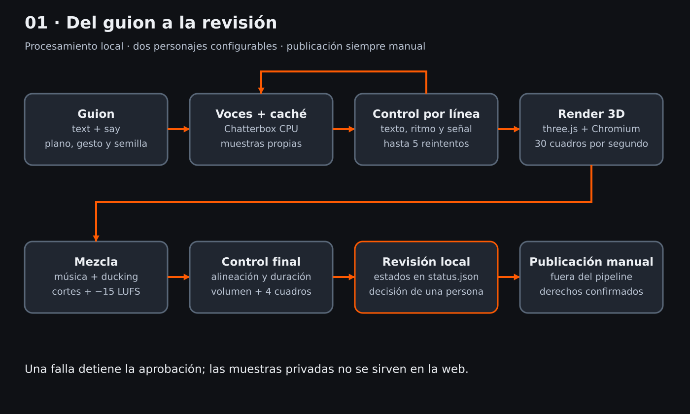
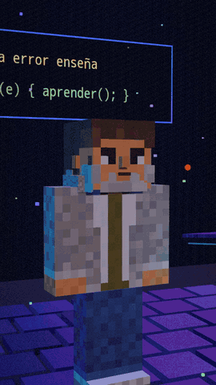
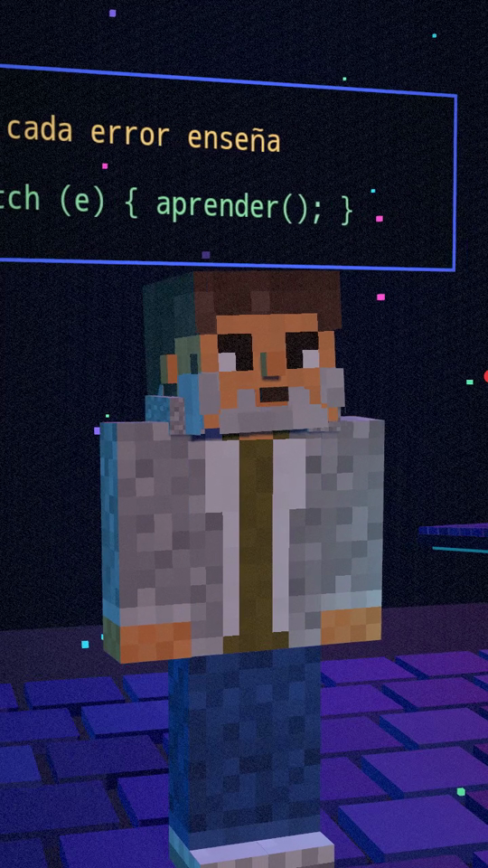
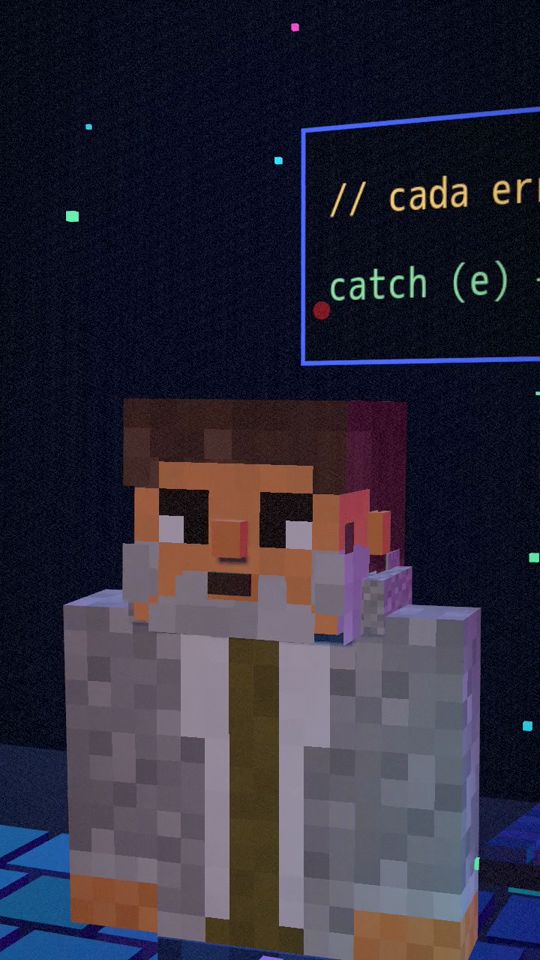
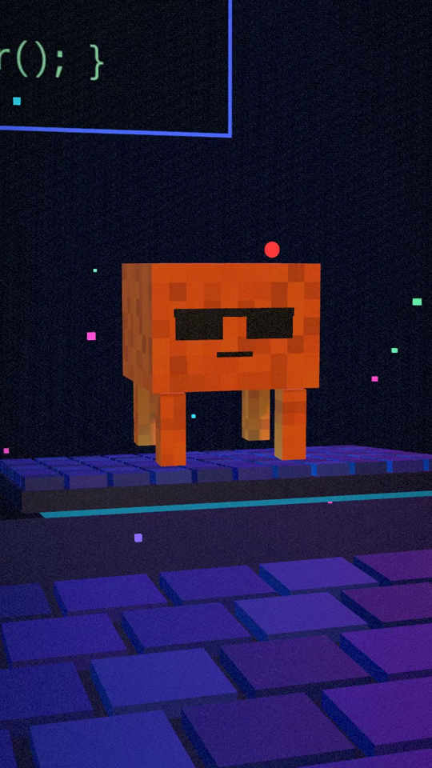
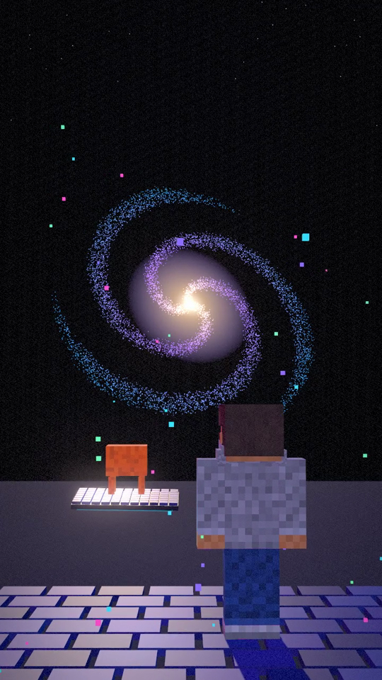
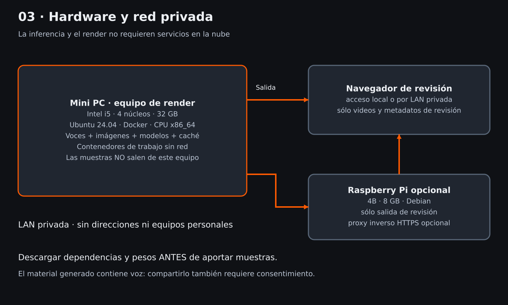

# AI Animated Shorts

> *Local, configurable 3D dialogue production — from script to human review.*

**Dos personajes, voces propias y un procedimiento reproducible para producir cortos animados sin inferencia en la nube.**

[English summary](README.en.md) · Autor: Mariano Araujo · Licencia MIT

## En un minuto

1. **Problema:** una voz puede omitir palabras, apurar el final o dejar silencios; renderizar antes de comprobarla desperdicia tiempo.
2. **Decisión:** separar guion, voz, control por línea, render y aprobación. Sólo se regeneran las líneas fallidas.
3. **Qué incluye:** personajes de bloques configurables, voces Chatterbox, controles con Whisper, render three.js, mezcla, página local y skill de instalación.
4. **Cómo verificar la lógica sin modelos ni internet:**
   ```bash
   python3 -m unittest discover -s tests -v
   bash tests/test_preflight.sh
   ```



[PNG de alta resolución](docs/assets/01-flujo.png)

## Así se ve

Cuadros y animación **sin sonido** de una serie propia del autor producida con este procedimiento: personajes de
bloques, plano vertical 720x1280, subtítulos impresos apagados (las redes agregan los suyos). Los personajes de la
serie tienen diseño propio; los del repositorio son ejemplos neutros que cada uno reemplaza por los suyos.



| Humano | Plano medio | IA | Cierre |
|---|---|---|---|
|  |  |  |  |

## Primero: aportar tus materiales

Este repositorio **no incluye fotos, muestras de voz ni voces clonadas**. Necesitás:

- Tu voz o una voz con consentimiento escrito: WAV mono PCM16, 24 o 44,1 kHz, 10–30 segundos, sin música ni eco. Guardala en `voices/samples/<personaje>.wav`.
- Imágenes propias o con licencia: frente y tres cuartos, fondo liso, al menos 1024 px por lado, en `characters/refs/`.
- Dos fichas en `voices/` y dos en `characters/`; los ejemplos son diseños neutros, no personas reales.

Las muestras son datos biométricos: **no subirlas a repositorios, nubes ni servicios externos**. Las carpetas están ignoradas por Git. Leé [cómo grabar, convertir, probar y ajustar](docs/feeding.md) antes de generar.

## Recorrido mínimo

Desde la raíz del repositorio, después de [instalar y descargar los modelos](docs/install.md):

```bash
bash src/preflight.sh
docker compose run --rm voice python src/check_inputs.py episodes/example
docker compose run --rm render node src/render/render.js episodes/example --preview
# Revisar output/example-preview.png y confirmar el render largo antes de continuar.
python3 src/pipeline.py episodes/example --confirm-render
docker compose up -d web
```

Abrí `http://localhost:8080`. Es un puerto de ejemplo ligado sólo a loopback, no un servicio público. El pipeline se detiene si una línea sigue fallando tras cinco reintentos; cambiá `say` y volvé a ejecutar. Nunca publica en redes.

## Qué hay en cada etapa

| Etapa | Implementación | Resultado |
|---|---|---|
| Guion | `episodes/<nombre>/script.json` | Texto, pronunciación opcional, planos y gestos |
| Voces | `src/voice.py` | WAV por hash + índice por línea, no por texto repetido |
| Control | `src/qa_audio.py`, `src/pipeline.py` | Palabras, última palabra, señal, silencios y semillas |
| Personajes | `src/character_from_image.py`, `characters/` | Propuesta de paleta ajustable, proporciones y rasgos |
| Render | `src/render/` | 720×1280 por defecto, 30 fps, boca por volumen |
| Mezcla | `src/music.py` y render | Música procedural, ducking, whoosh, −15 LUFS |
| Control final | `src/qa_audio.py video` | Alineación, huecos, duración, volumen y cuatro cuadros |
| Revisión | `web/`, `src/status.py` | Revisión / Pruebas / Aprobados / Producción |

Los subtítulos impresos están **desactivados por defecto**. `"subtitles": true` los activa; de otro modo se deja el video limpio para la subtitulación de la plataforma elegida.

## Hardware y tiempos

Mini PC Intel i5 de cuatro núcleos y 32 GB, Ubuntu 24.04, Docker, sin GPU. Una Raspberry Pi 4B de 8 GB con Debian puede servir **sólo la salida de revisión**; no sintetiza ni renderiza.

Mediciones aportadas del proyecto de referencia en **i5-10210U, ocho hilos, 32 GB**: video de 66 s ≈ 19–31 min de render; video de 40 s ≈ 19 min; voz ≈ 20–35 s por línea; MP4 ≈ 250 MB. No son benchmarks de esta implementación ni garantías de tamaño o rendimiento.



## Instalación asistida

Copiá `skill/ai-animated-shorts/` a `~/.claude/skills/ai-animated-shorts/` y pedile a Claude Code que la use indicando la raíz del repo. La skill pide muestras propias y confirmación antes de cada render largo. No manda muestras a ningún servicio. [Instalación completa](docs/install.md).

## Alcance y límites

El código sirve para cualquier par de personajes y guion compatibles con su esquema. Las fichas generan un rig básico de bloques; la imagen propone colores, **no reconstruye automáticamente un modelo 3D fiel**. Hay tres escenarios (`studio`, `night`, `garden`) y cinco planos; para escenarios nuevos se amplía `scene.js`.

Chatterbox y Whisper deben soportar el idioma elegido. Las tasas de caracteres y la segmentación por palabras necesitan ajuste para idiomas sin espacios; el control no certifica inteligibilidad ni pronunciación humana. Las voces, imágenes y música requieren derechos propios.

La instalación descarga paquetes y pesos una vez; la producción queda sin red en los contenedores `voice`, `qa` y `render`. No confundir producción local con instalación sin internet. No se entregan pesos. La revisión humana final sigue siendo necesaria.

[Arquitectura](docs/architecture.md) · [Alimentación](docs/feeding.md) · [Guion](docs/script-format.md) · [Calidad](docs/quality-control.md) · [Hardware](docs/hardware.md) · [Decisiones](docs/decisions.md) · [Límites y validación](docs/limitations.md) · [Licencias de terceros](NOTICE.md)
