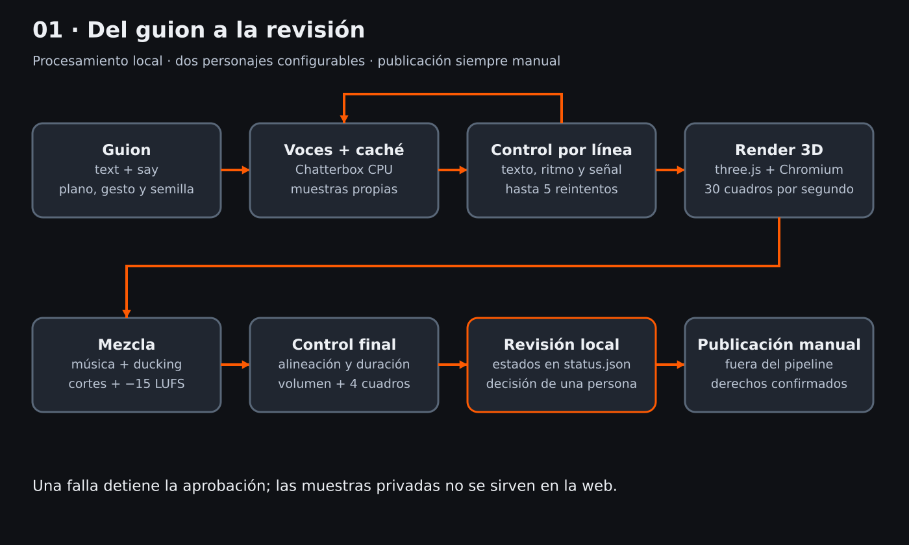
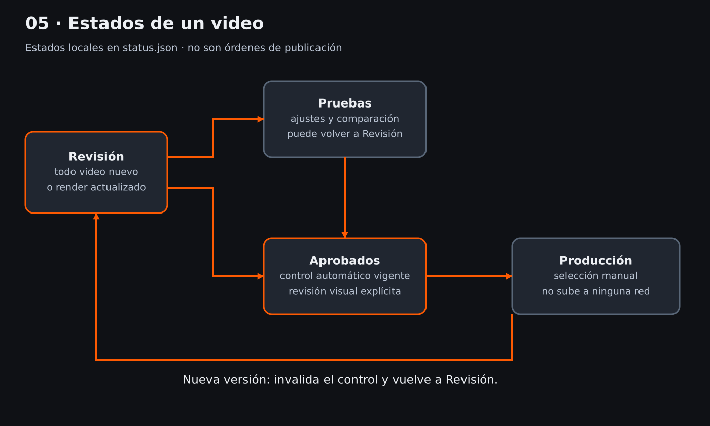

# Arquitectura local

El guion y las fichas son entradas públicas de ejemplo. Las voces e imágenes del usuario, los pesos, la caché y las salidas quedan fuera de Git. Cada comando opera desde la raíz; los paths de entradas se resuelven dentro de ella y se rechazan escapes.

`voice` sintetiza con Chatterbox; `qa` transcribe y mide; `render` captura una escena parametrizada; `web` sirve únicamente HTML y el directorio de salida. Los tres primeros contenedores tienen red deshabilitada; Chromium usa un servidor loopback efímero con lista cerrada de recursos de escena. Ese servidor no sirve muestras ni archivos arbitrarios.

La preparación descarga dependencias y pesos sin datos privados montados. La producción no hace consultas externas. La página de revisión sólo monta `output/`: ni `voices/samples/` ni `characters/refs/` quedan accesibles por nginx.

Los hashes vinculan guion, índice, WAV, informes y MP4. El almacenamiento JSON usa reemplazo de archivo; no hay base de datos ni cola de trabajos. Se admite una ejecución por episodio, no coordinación concurrente. No es un servicio multiusuario.

La página obtiene la lista de MP4 con el autoindex JSON restringido de nginx. Los estados se leen de `status.json`; si falta el archivo, el nombre o el hash no coincide, corresponde Revisión. El cambio manual se hace con `src/status.py`. Una regeneración borra el estado anterior de ese video.

La geometría es procedural: cinco planos, caras simples y boca animada por la envolvente RMS. La textura pixelada se genera localmente. La imagen privada sólo ayuda a proponer colores; no se embebe en el render ni se copia a la web.
