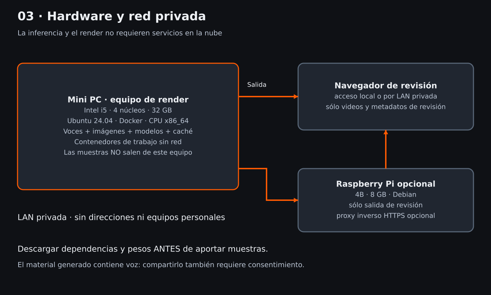

# Hardware y red

| Equipo | Trabajo | Requisito |
|---|---|---|
| Mini PC Intel i5, cuatro núcleos, 32 GB | voz, QA, render y mezcla | Ubuntu 24.04, CPU x86_64, Docker Compose |
| Raspberry Pi 4B, 8 GB, opcional | servir sólo salidas de revisión | Debian, nginx/proxy HTTPS opcional |
| Navegador del revisor | escuchar, mirar, decidir | acceso local o LAN privada |

16 GiB de RAM es la recomendación mínima del preflight, no un cálculo de pico garantizado. Reservá al menos 25 GiB libres y margen adicional para imágenes Docker, pesos y episodios. Usá SSD y refrigeración; una CPU limitada térmicamente tarda más. El render usa software SwiftShader, no GPU. El objetivo es x86_64: no se promete render ni voz en ARM.

Mediciones **del proyecto de referencia**, en i5-10210U (cuatro núcleos / ocho hilos), 32 GB: 66 s → 19–31 min de render; 40 s → aproximadamente 19 min; 20–35 s por línea de voz en CPU; MP4 aproximadamente 250 MB. El bitrate varía con escena, CRF y movimiento: 250 MB no es un tamaño objetivo ni una medición de este repo.

Los servicios se ejecutan secuencialmente para reducir presión de memoria. La Pi no recibe muestras de voz, referencias ni pesos: sólo el material de revisión que se decida copiar. La voz generada en el video también es material sensible; compartirla requiere consentimiento.

El puerto de ejemplo de Compose escucha únicamente en loopback. Acceso desde otra máquina requiere configurar conscientemente un proxy autenticado o túnel. Un proxy HTTPS no sustituye autorización. No se entregan dominios privados, hostnames ni reglas específicas de una red real.
