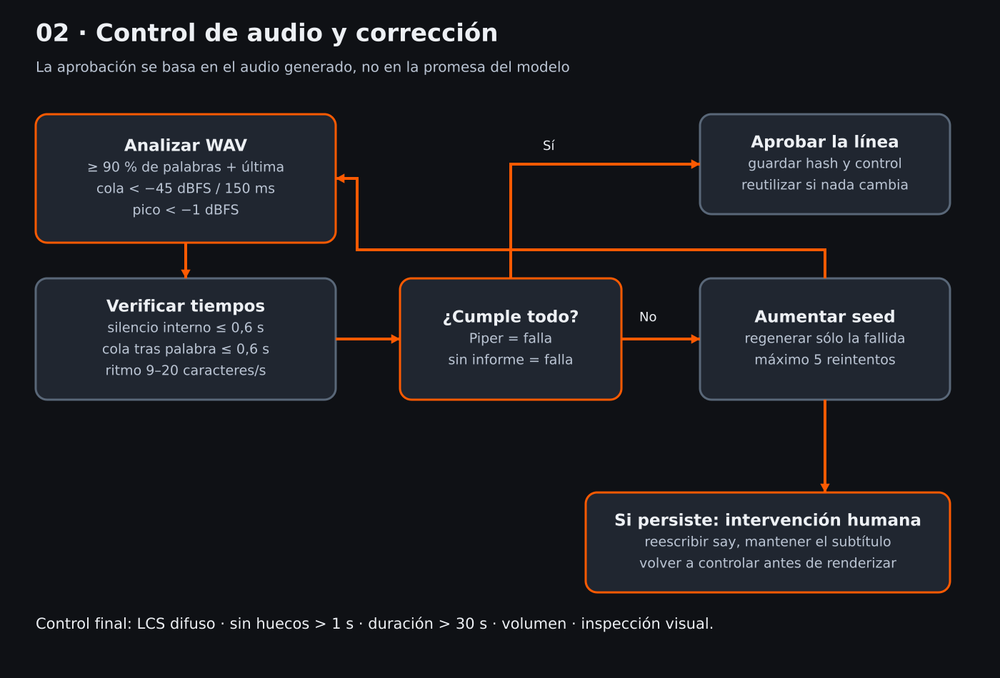

# Control de calidad

## Por línea

| Criterio | Umbral | Implementación |
|---|---|---|
| Palabras esperadas | ≥90 % en orden | LCS difuso, comparación Unicode sin diacríticos |
| Última palabra | presente y al final | comparación adicional al porcentaje |
| Cola en silencio | RMS < −45 dBFS | últimos 150 ms del WAV |
| Pico | < −1 dBFS | PCM mono, antes de mezcla |
| Silencio interno | ≤0,6 s | ventanas de 10 ms entre primer y último segmento activo |
| Cola después de última palabra | ≤0,6 s | timestamps de Whisper |
| Ritmo | 9–20 car/s | texto pronunciado / duración real |
| Motor | Chatterbox | Piper siempre es falla |

Whisper `small`, CPU int8, timestamps por palabra, sin servicios externos. Se controla el WAV después de aplicar `tempo`, no una versión anterior. La función pura `review()` y la alineación se prueban con señal sintética y transcripciones simuladas.

Un fallo dispara una nueva semilla sólo para esa línea; máximo cinco reintentos adicionales a la toma inicial. Si persiste, el coordinador termina con error y pide reescribir `say`. No reintenta indefinidamente ni convierte errores de modelo en aprobaciones. Un proceso de QA abortado no reutiliza un reporte anterior.

## Video completo

Se vuelve a transcribir el MP4 mezclado. La alineación LCS global conserva el orden y asigna cada palabra a su línea; se exige ≥90 % y la última palabra por línea. Falla por huecos mayores de 1 s entre líneas alineadas, duración ≤30 s, fallback Piper, LUFS fuera de −15 ±1,5 o pico real ≥−1 dBTP.

La mezcla usa ducking, música baja, whooshes de cortes y `loudnorm` con objetivo −15 LUFS / −1,5 dBTP. Un paso de normalización no garantiza ese resultado exacto: el control lo mide y rechaza desvíos.

Se extraen cuatro PNG al 10, 35, 65 y 90 % del video. **No hay un clasificador visual automático:** el informe marca revisión visual pendiente. Una persona debe inspeccionar rostro, encuadre, boca, transiciones, subtítulos y escuchar todo. `--visual-reviewed` es una declaración explícita de esa revisión, no una prueba de que haya ocurrido.

Aprobados y Producción exigen informe exitoso con hash igual al MP4 actual. Si el archivo cambia, el informe pierde validez. Los estados no suben contenido a redes.

## Limitaciones del control

Los números deben escribirse como se desea pronunciarlos en `say`; «20» y «veinte» no se equiparan automáticamente. Tolerancia difusa ≥0,8 para palabras de al menos cuatro letras; palabras cortas requieren igualdad. Puede haber falsos rechazos o falsos positivos. Para chino/japonés se alinean caracteres ideográficos y kana; no es una segmentación lingüística en palabras. Otros idiomas sin espacios requieren adaptar tokenización/umbrales antes de confiar en el control. La transcripción automática no reemplaza una escucha competente en ese idioma.
